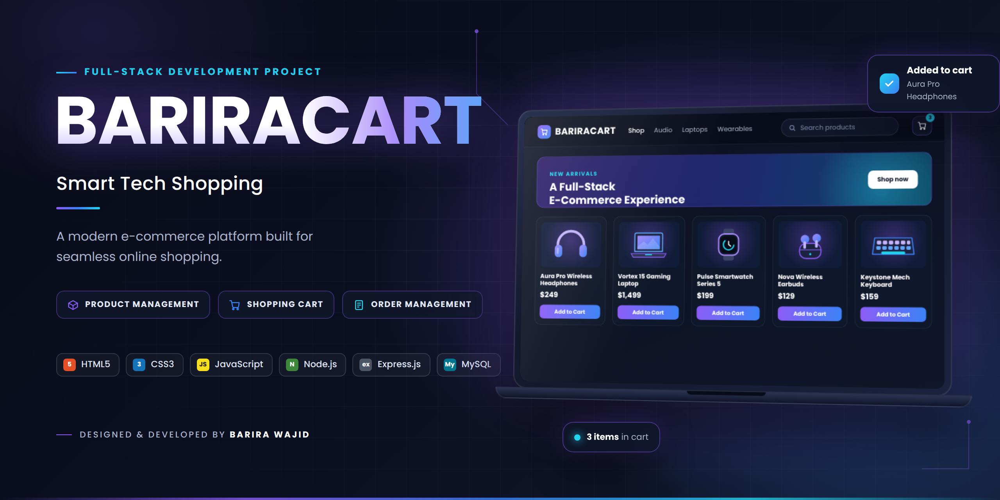

<p align="center">
  
</p>

<h1 align="center">🛒 BariraCart — Smart Tech Shopping</h1>

<p align="center">
  
</p>

<p align="center">
  A modern full-stack e-commerce web application built as part of my Full Stack Development internship.
</p>

<p align="center">
  
  
  
</p>

---

## 🌟 About BariraCart

BariraCart is a modern technology shopping platform designed to provide a smooth and user-friendly online shopping experience.

It includes product browsing, search, cart management, checkout, order processing, and an admin dashboard for managing products and orders.

---

## ✨ Features

### 🛍️ Customer Side

* Browse products
* Search products
* Product categories
* Product details
* Add to cart
* Increase/decrease quantity
* Remove products from cart
* Persistent cart using LocalStorage
* Checkout system
* Order placement
* Order ID generation
* Responsive design

### 🔐 Admin Side

* Admin login
* Dashboard statistics
* Total orders
* Pending orders
* Recent orders
* Order management
* Order details
* Update order status
* Add products
* Edit products
* Delete products
* Stock management

---

## 💻 Technologies Used

<p align="center">
  
  
  
  
  
  
</p>

### Frontend

* HTML5
* CSS3
* JavaScript
* LocalStorage
* Responsive Design

### Backend

* Node.js
* Express.js

### Database

* MySQL

### Tools

* XAMPP
* phpMyAdmin
* Git
* GitHub
* Visual Studio Code

---

## 📂 Project Structure

```text
BariraCart/
│
├── index.html
├── product.html
├── checkout.html
├── admin-login.html
├── admin-dashboard.html
├── admin-orders.html
├── admin-order-details.html
├── admin-products.html
│
├── style.css
├── script.js
├── server.js
├── db.js
│
├── package.json
└── Product Images/
```

---

## 🗄️ Database

BariraCart uses MySQL to manage:

* Users
* Products
* Orders
* Order Items
* Order Status

---

## ⚙️ Installation & Setup

Follow these steps to run BariraCart locally.

**1. Clone the repository**

```bash
git clone https://github.com/Barira-Wajid/BariraCart.git
```

**2. Open the project folder**

```bash
cd BariraCart
```

**3. Install dependencies**

```bash
npm install
```

**4. Configure the database**

* Start MySQL using XAMPP.
* Make sure the BariraCart database is available.
* Configure your database connection in `db.js`.

**5. Start the server**

```bash
node server.js
```

**6. Open the application**

```text
http://localhost:3000
```

---

## 📦 Order Management

Orders can move through the following stages:

<p align="center">
  
  →
  
  →
  
  →
  
</p>

---

## 🎯 Internship Project

**Program:** CodeAlpha Full Stack Development Internship

**Project:** BariraCart — Smart Tech Shopping

**Developer:** Barira Wajid

---

## 🚀 Future Improvements

* Online payment integration
* User registration and login
* Product reviews and ratings
* Wishlist functionality
* Advanced product filtering
* Email order notifications

---

## 👩‍💻 Developer

<h3 align="center">Barira Wajid</h3>

<p align="center">
  Full-Stack Web Developer | Creative Designer
</p>

<p align="center">
  <a href="https://github.com/Barira-Wajid">
    
  </a>
  <a href="https://www.linkedin.com/in/%20barira-wajid-554701425">
    
  </a>
  <a href="https://bariraportfolio.rf.gd/">
    
  </a>
</p>

---

<p align="center">
  <b>✨ Dream it. Build it. Improve it.</b>
  <br><br>
  Made with ❤️ by Barira Wajid
</p>
